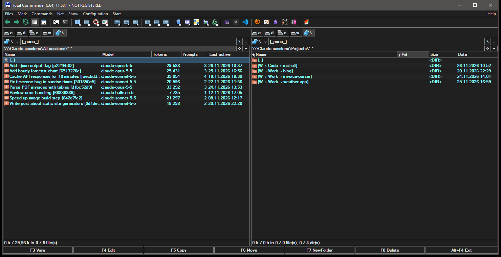
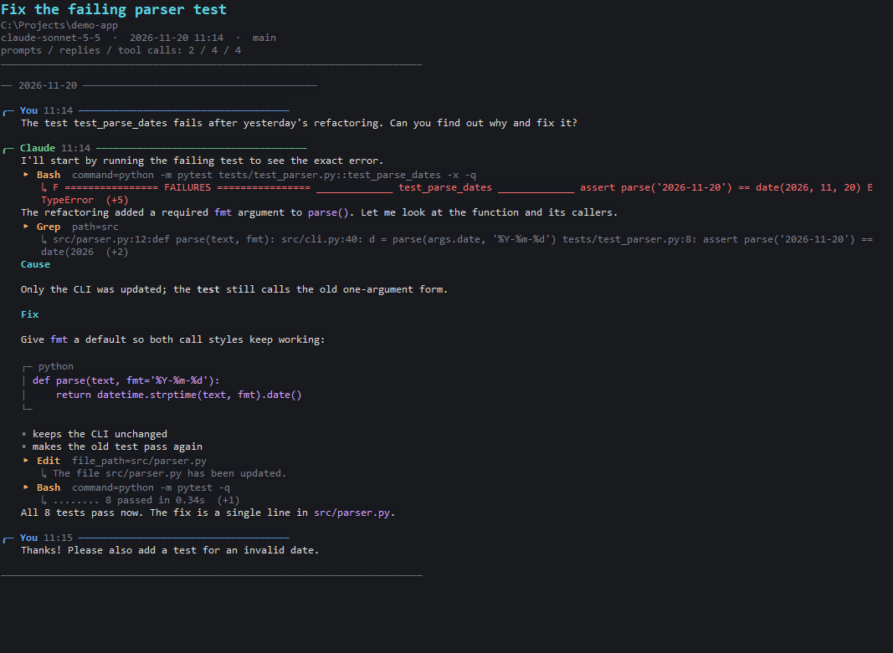

## ClaudeSessions 1.4 — Total Commander plugins for Claude Code sessions

### What's new in 1.4
- File system: every folder has an **ⓘ Overview** entry (Total Commander cannot show a folder of a file system plugin with F3): All sessions, Projects, a project, Settings, Skills, Agents, Memory. F3 or Enter opens it in Lister.
- File system: F3 on **Sessions trash** lists the sessions in it per project.
- Lister: the texts of the file system (overviews, version, trash, limits) open in ClaudeSessions too, so Quick View moving on to a session no longer ends up in another text viewer. New Lister detect string: `EXT="JSONL" | ([0]=239 & [1]=187 & [2]=191)` (an entry from an earlier version keeps the old one: change it under Configuration › Options › Plugins › Lister, or remove the plugin there and install the zip again).
- File system: a path opened with a trailing `\` (`\\\Claude sessions\...\`) works again for skills and settings files.
- `Log=1` in the `[fs]` section writes what Total Commander asks the plugin for into `ClaudeSessions.log` (for bug reports).

### What's new in 1.3
- File system: the root shows the installed **Claude Code version** (`Claude Code 2.1.330 → 2.1.332` when a newer one exists). **Enter on it updates Claude Code** in a console window.
- File system: a **Settings** folder: environment variables that matter to Claude Code (secrets masked), **skills** and **agents** named after their description, **MCP servers**, `CLAUDE.md`, `settings.json`, `keybindings.json`. F3/F4 work on the real files.
- File system: every project has a **Memory** folder (the auto-memory files of that project).
- File system: **Sessions trash — N** in the root (Enter goes to the real folder); weekly Opus/Sonnet limits and the plan in the limit details, when the subscription has them.
- New icons for all of them.

### What's new in 1.2
- File system: the root shows the **5-hour and weekly limits** of the Claude subscription under the two folders (`5-hour limit — 26%`, `Weekly limit — 32%`), with the reset time in the date column and own icons (a clock and a calendar). The same data as `/usage` in Claude Code; nothing to set up.

### What's new in 1.1
- File system: the root has two folders, **All sessions** (every session of every project in one list) and **Projects**; own icons for them, for the project folders and for the sessions.
- File system: content plugin columns (any WDX, including ClaudeSessions' own fields) now work inside the virtual folder too.
- File system: **Alt+Enter** opens a small menu: go to the real project folder, resume, properties.
- File system: **F8** moves a session to `sessions-trash` next to `projects` (restorable) instead of being refused.
- Resume: finds `claude` also when Claude Code was installed after Total Commander started (PATH, `%USERPROFILE%\.local\bin`, `%APPDATA%\npm`), and says so clearly when it is missing; the Claude Code session markers of a parent process are removed from the environment, so the resumed session keeps saving its transcript.
- Content: new fields **Tokens**, **OutputTokens**, **CacheReadTokens**; field names follow the language of Total Commander (English, Russian, Ukrainian).

Claude Code (Anthropic's CLI) saves every conversation as a `*.jsonl` file in its `projects` folder. Those files are large, unreadable by eye and have no names. **ClaudeSessions** makes them usable inside Total Commander. It is **one DLL that works as three plugins**: copy it as `.wlx64` (Lister), `.wfx64` (file system) or `.wdx64` (content). Total Commander loads only the functions it needs from each copy. 32-bit (`.wlx/.wfx/.wdx`) and 64-bit builds are included. Only system DLLs are used, no other software is required. Freeware (closed source).

### File system plugin "Claude sessions" (WFX)
A virtual folder in *Network Neighborhood* (the "Network" button of the drive bar, or `\\\Claude sessions` in the command line). It **finds the Claude Code data by itself**: `CLAUDE_CONFIG_DIR`, a `Programs\Claude\data` layout, `%USERPROFILE%\.claude`, or `Path=` in the ini.

**The root** has two folders with their own icons: **All sessions** and **Projects**. Inside **Projects** there is one folder per project, named after the real project path (`W › Work › weather-app` for `W:\Work\weather-app`); inside it the sessions of that project. Every session is shown as `Session title [first 8 characters of the id].jsonl`, so you see what a conversation was about instead of a bare id.

**All sessions** lists every session of every project in one place: sort by date (or by *Last active*) to find the latest conversation wherever it was started. The fields of the content plugin work as columns here (and so do other content plugins): below a column set with *Model*, *Tokens*, *Prompts* and *Last active*; the right panel shows the project folders.

Available fields: Title, Started, LastActive, Messages (prompts), Project, Model, Id, Tokens, OutputTokens, CacheReadTokens. Info is read quickly (head and tail of the file) and cached; the prompt and token counts need the whole file and are calculated in the background. To make a column set: *Configuration › Options › Custom columns › New*, then add fields from the `claudesessions` plugin. (Tip: with the *Ext* column hidden, Total Commander may show `..` in the first custom column; put a text column such as Model first.)

**Limits.** Under the two folders the root shows how much of the Claude subscription's **5-hour** and **weekly** limit is used, for example `5-hour limit — 26%` and `Weekly limit — 32%`; the date column shows when the limit resets. Enter, Alt+Enter or F3 shows the details (percent, reset time, when the data was read). The names follow the language of Total Commander.
- The numbers are the same as `/usage` in Claude Code and come from the same place: the plugin reads the Claude Code login token from `.credentials.json` in the Claude data folder and asks `api.anthropic.com` (the address Claude Code itself uses for `/usage`). The token is only read: it is never refreshed, stored or sent anywhere else.
- At most one request a minute, in the background; Ctrl+R in the root shows the newest numbers.
- No login with a subscription (an API key has no such limits), an expired token (Claude Code not started for some hours) or no network: the entries keep the last values or are not shown. `Limits=0` in the `[fs]` section of the ini switches them off.

**Claude Code version.** The root shows the installed version (read from `claude.exe` or the npm package, without starting it). Every 6 hours the plugin asks the npm registry for the newest version of your update channel (`latest` or `stable` from `settings.json`; no login, nothing about you is sent) and shows `Claude Code 2.1.330 → 2.1.332` when there is one. Enter shows the details and offers to update: a console window runs `update.cmd` next to a portable `claude.cmd` launcher if there is one, otherwise the official `claude update`. Installed with winget or another package manager, or a portable `claude.exe` with its own updater: set `UpdateCommand=` in the ini (`{claude}`, `{version}`, `{channel}`). Ctrl+R afterwards shows the new version.

**Settings** (a folder in the root):
- **Environment**: the variables that matter to Claude Code as `NAME = value`, from `settings.json` (`env`), the Windows variables of the user and the system, and the environment of Total Commander. API keys, tokens and passwords are masked (`sk-a…1234`). F3 shows a short description, every source and which one applies. Read-only.
- **Skills** and **Agents**: `name — description.md`; F3 views, F4 edits the real `SKILL.md` / agent file, Enter opens it with its program, Alt+Enter goes to the real folder. The *Title* column shows the full description.
- **MCP servers** (when there are any): user, local and project (`.mcp.json`) servers with type and command or URL; names of variables and headers only, never their values. Read-only.
- `CLAUDE.md`, `settings.json`, `keybindings.json`: the real files (F3, F4).

An edited file is written back only over an existing skill, agent, memory or settings file; nothing new is created there and sessions are never written.

**Memory.** Every project folder has a **Memory** folder with the auto-memory files of that project (F3, F4 on the real files).

**Sessions trash — N** appears in the root when F8 has moved sessions there; Enter or Alt+Enter goes to the real folder. Characters Windows does not allow in names (and dots, which Total Commander would take for an extension) are shown as look-alikes (`D∶∖Programs`, `2․1․330`).

**Overview.** Total Commander does not ask a file system plugin to show a folder with F3, so every folder has an **ⓘ Overview** entry: F3 or Enter sums the folder up in Lister.
- **All sessions**: number and size of the sessions, the first and the last one, active ones in the last 7 and 30 days, activity of the last 14 days as a bar chart, models, tokens (of the sessions already counted by the token columns), the biggest sessions.
- **Projects**: every project with its sessions, size, last activity, memory and `CLAUDE.md`; projects whose folder no longer exists (resume will not work there).
- **A project**: its folder, the same statistics, the newest sessions, its memory files, Claude files in the project folder (`CLAUDE.md`, `.mcp.json`, `.claude\settings.json`, ...).
- **Settings**: what `settings.json` and `settings.local.json` set (model, update channel, permission rules, hooks, plugins, status line, env), numbers of skills, agents, MCP servers and variables.
- **Skills**, **Agents**: every one with its full description. **Memory**: the memory files with their descriptions and `MEMORY.md`.

`Version=0`, `UpdateCheck=0`, `Settings=0`, `Overview=0` in the `[fs]` section of the ini switch these parts off.

**Keys inside the file system**
- **Enter** resumes the session: opens a terminal in the project folder and runs `claude --resume <session id>` (Windows Terminal if present, otherwise cmd). Configurable: terminal, launcher, or your own command line with `{cwd} {id} {claude}`; Enter can also be set to copy instead.
- **Alt+Enter** opens a small menu: **Go to the project folder** (the active panel jumps to the real folder the session was started in), **Resume the session**, **Properties** (title, project, model, dates, prompts, file).

- **F3** shows the conversation in the Lister plugin (below).
- **F5** copies the `.jsonl` (or a Markdown version with `ExportMd=1`).
- **F8** moves a session to `sessions-trash` next to `projects`, in a subfolder per project (restorable; Total Commander asks first). Nothing is deleted for good, renamed or moved otherwise.

### Lister plugin (WLX)
F3 on any `*.jsonl` shows the conversation in its own terminal-style window:
- colours per role (you / Claude / tools / errors), box-drawing headers with the session title, project, model and dates;
- tool calls (`>`) with their results, light Markdown (headings, lists, code blocks, **bold**, `code`), long lines wrap;
- **R** cycles tool results (hide / short / full), **T** shows or hides the model's thinking, Ctrl+F / F7 search, N / P next and previous file;
- right click: the same options, Copy, Select all and **Save as Markdown…**;
- light/dark theme and language (English, Russian, Ukrainian) follow Total Commander. Big sessions (800 KB+) open in well under a second.

### Content plugin (WDX)
Title, Started, LastActive, Messages (prompts), Project, Model, Id, Tokens, OutputTokens, CacheReadTokens for `*.jsonl` files in ordinary folders too (search, sort, columns, tooltips). The field names follow the language of Total Commander (English, Russian, Ukrainian).

### Install
Download one of the installers (`ClaudeSessions-WFX/WLX/WDX-1.4.zip`), open it in Total Commander (Enter) and confirm, or take `ClaudeSessions-1.4.zip` with everything and register the files by hand. Lister detect string: `EXT="JSONL" | ([0]=239 & [1]=187 & [2]=191)` (the UTF-8 BOM part is for the texts of the file system: overviews, version, trash, limits; the plugin takes only its own, so Quick View moving on to a session stays in this plugin). Settings: `ClaudeSessions.ini` next to the DLL (see `ClaudeSessions.ini.example`).

### Notes
- Sessions can contain private data (paths, command output, file contents); a Markdown export contains it too. Share exports with care.
- Resuming finds `claude` by itself: a portable `claude.cmd` next to the data folder, PATH, `%USERPROFILE%\.local\bin` or `%APPDATA%\npm` (or `Claude=` in the ini).
- Resuming needs the original project folder to exist (Claude Code finds a session by the folder it was started in).
- Tested with 64-bit Total Commander; the 32-bit build comes from the same source and has had less testing.
- Bug reports and ideas: GitHub Issues.
- If it is useful to you, you can support the work: https://send.monobank.ua/jar/7EiyaxfeWZ
