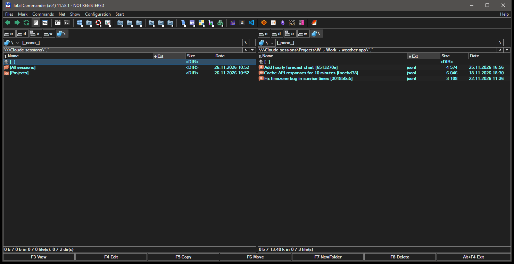
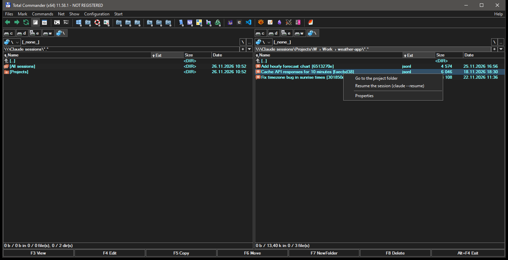

## ClaudeSessions 1.1 — Total Commander plugins for Claude Code sessions

### What's new in 1.1
- File system: the root has two folders, **All sessions** (every session of every project in one list) and **Projects**; own icons for them, for the project folders and for the sessions.
- File system: content plugin columns (any WDX, including ClaudeSessions' own fields) now work inside the virtual folder too.
- File system: **Alt+Enter** opens a small menu: go to the real project folder, resume, properties.
- File system: **F8** moves a session to `sessions-trash` next to `projects` (restorable) instead of being refused.
- Resume: finds `claude` also when Claude Code was installed after Total Commander started (PATH, `%USERPROFILE%\.local\bin`, `%APPDATA%\npm`), and says so clearly when it is missing; the Claude Code session markers of a parent process are removed from the environment, so the resumed session keeps saving its transcript.
- Content: new fields **Tokens**, **OutputTokens**, **CacheReadTokens**; field names follow the language of Total Commander (English, Russian, Ukrainian).

Claude Code (Anthropic's CLI) saves every conversation as a `*.jsonl` file in its `projects` folder. Those files are large, unreadable by eye and have no names. **ClaudeSessions** makes them usable inside Total Commander. It is **one DLL that works as three plugins**: copy it as `.wlx64` (Lister), `.wfx64` (file system) or `.wdx64` (content). Total Commander loads only the functions it needs from each copy. 32-bit (`.wlx/.wfx/.wdx`) and 64-bit builds are included. Only system DLLs are used, no other software is required. Freeware (closed source).

### File system plugin "Claude sessions" (WFX)
A virtual folder in *Network Neighborhood* (the "Network" button of the drive bar, or `\\\Claude sessions` in the command line). It **finds the Claude Code data by itself**: `CLAUDE_CONFIG_DIR`, a `Programs\Claude\data` layout, `%USERPROFILE%\.claude`, or `Path=` in the ini.

**The root** has two folders with their own icons: **All sessions** and **Projects**. Inside **Projects** there is one folder per project, named after the real project path (`W › Work › weather-app` for `W:\Work\weather-app`); inside it the sessions of that project. Every session is shown as `Session title [first 8 characters of the id].jsonl`, so you see what a conversation was about instead of a bare id.

**All sessions** lists every session of every project in one place: sort by date (or by *Last active*) to find the latest conversation wherever it was started. The fields of the content plugin work as columns here (and so do other content plugins): below a column set with *Model*, *Tokens*, *Prompts* and *Last active*; the right panel shows the project folders.

Available fields: Title, Started, LastActive, Messages (prompts), Project, Model, Id, Tokens, OutputTokens, CacheReadTokens. Info is read quickly (head and tail of the file) and cached; the prompt and token counts need the whole file and are calculated in the background. To make a column set: *Configuration › Options › Custom columns › New*, then add fields from the `claudesessions` plugin. (Tip: with the *Ext* column hidden, Total Commander may show `..` in the first custom column; put a text column such as Model first.)

**Keys inside the file system**
- **Enter** resumes the session: opens a terminal in the project folder and runs `claude --resume <session id>` (Windows Terminal if present, otherwise cmd). Configurable: terminal, launcher, or your own command line with `{cwd} {id} {claude}`; Enter can also be set to copy instead.
- **Alt+Enter** opens a small menu: **Go to the project folder** (the active panel jumps to the real folder the session was started in), **Resume the session**, **Properties** (title, project, model, dates, prompts, file).

- **F3** shows the conversation in the Lister plugin (below).
- **F5** copies the `.jsonl` (or a Markdown version with `ExportMd=1`).
- **F8** moves a session to `sessions-trash` next to `projects`, in a subfolder per project (restorable; Total Commander asks first). Nothing is deleted for good, renamed or moved otherwise.

### Lister plugin (WLX)
F3 on any `*.jsonl` shows the conversation in its own terminal-style window:
- colours per role (you / Claude / tools / errors), box-drawing headers with the session title, project, model and dates;
- tool calls (`>`) with their results, light Markdown (headings, lists, code blocks, **bold**, `code`), long lines wrap;
- **R** cycles tool results (hide / short / full), **T** shows or hides the model's thinking, Ctrl+F / F7 search, N / P next and previous file;
- right click: the same options, Copy, Select all and **Save as Markdown…**;
- light/dark theme and language (English, Russian, Ukrainian) follow Total Commander. Big sessions (800 KB+) open in well under a second.

### Content plugin (WDX)
Title, Started, LastActive, Messages (prompts), Project, Model, Id, Tokens, OutputTokens, CacheReadTokens for `*.jsonl` files in ordinary folders too (search, sort, columns, tooltips). The field names follow the language of Total Commander (English, Russian, Ukrainian).

### Install
Download one of the installers (`ClaudeSessions-WFX/WLX/WDX-1.1.zip`), open it in Total Commander (Enter) and confirm, or take `ClaudeSessions-1.1.zip` with everything and register the files by hand. Lister detect string: `EXT="JSONL"`. Settings: `ClaudeSessions.ini` next to the DLL (see `ClaudeSessions.ini.example`).

### Notes
- Sessions can contain private data (paths, command output, file contents); a Markdown export contains it too. Share exports with care.
- Resuming finds `claude` by itself: a portable `claude.cmd` next to the data folder, PATH, `%USERPROFILE%\.local\bin` or `%APPDATA%\npm` (or `Claude=` in the ini).
- Resuming needs the original project folder to exist (Claude Code finds a session by the folder it was started in).
- Tested with 64-bit Total Commander; the 32-bit build comes from the same source and has had less testing.
- Bug reports and ideas: GitHub Issues.
- If it is useful to you, you can support the work: https://send.monobank.ua/jar/7EiyaxfeWZ
